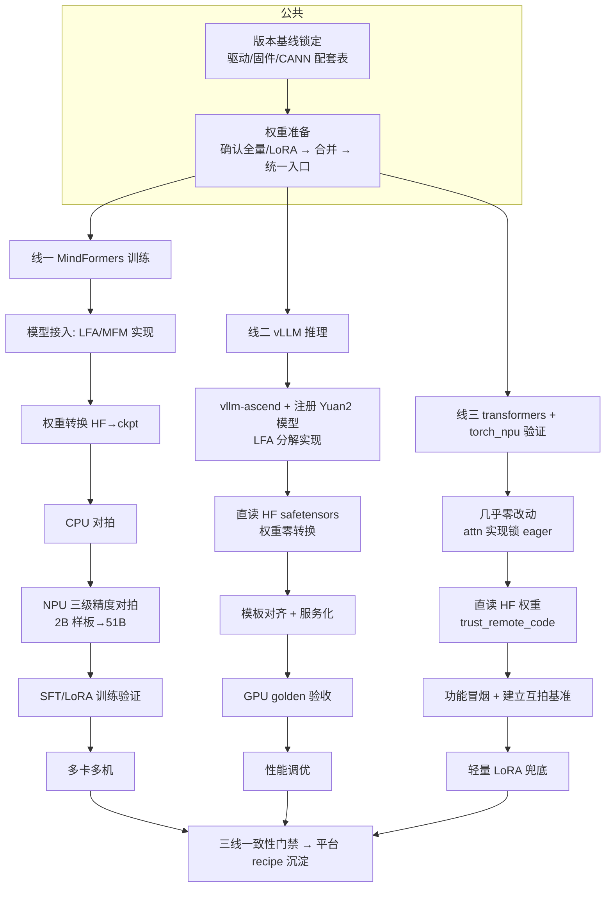

# 浪潮源 2.0（Yuan 2.0）昇腾 910B 适配流程复盘 —— MindFormers 训练线 + vLLM 推理线（2024）

> 对应《难点一-昇腾910B异构适配-详细解决方案.md》里"浪潮侧定制模型"的具体展开。
> 本文按 2024 年实际执行的适配 SOP 复原：**版本号为示例基线，模型结构细节以当时源码/仓库为准**，与现场记录有出入的地方直接改本文。

---

## 0. 面试 30 秒总述

> "源 2.0 和百川不一样——它不是纯 LLaMA 变体，attention 是浪潮自研的 **LFA（局部过滤注意力）**，FFN 是 **MFM（多头多滤波）**，也就是说昇腾现成的 FlashAttention 融合算子根本用不上，两边都要自己实现。我们走三条线：**训练侧 MindFormers**（核对版本支持矩阵 → 补齐 LFA/MFM 实现 → 权重转换 → 三级精度对拍 → SFT/LoRA 验证），**推理侧 vLLM**（官方 vLLM 分支是 CUDA kernel，NPU 上编译不过，最终在 vllm-ascend 插件上注册 Yuan2 模型实现，LFA 分解成带状矩阵乘 + decode 侧 score 环形缓存），外加一条 **transformers + torch_npu 原生实现线**——Yuan2 的 HF 实现是纯 PyTorch 算子，torch_npu 几乎零改动就能跑，负责快速验证和三线互拍的中间锚点。2B 先当样板打通，51B 作为主战场。首次全流程约两周，沉淀成 recipe 后同类适配压到一天以内。"

---

## 1. 适配对象档案：源 2.0 是什么、难在哪

### 1.1 型号矩阵与发布形态

| 型号 | 发布 | 规模 | 备注 |
|---|---|---|---|
| 源 2.0-2B | 2023.11 | 2.1B | **调试样板**：小、迭代快，所有转换/对拍先在它上面跑通 |
| 源 2.0-51B | 2023.11 | 51B | **主战场**：推理 TP8 单机可放，训练以 LoRA 为主 |
| 源 2.0-102B | 2023.11 | 102.6B | 当时未上（如涉及需跨机 PP） |
| Yuan2.0-M32 | 2024.04 | MoE/32 专家 | 如涉及需另配 EP 方案，与稠密版流程不同 |

发布形态注意点：51B/102B 官方发布过 **LoRA 形态权重**（预训练全量基座 + LoRA 续训增量）——拿到手第一件事是**确认是全量还是 LoRA，LoRA 要先与基座合并**，否则转换出来的 ckpt 就是错的（且不报错）。权重入口：GitHub IEIT-Yuan/Yuan-2.0、HF IEITYuan 组织、ModelScope。论文：arXiv:2311.15786。

### 1.2 三个非标准结构（与 LLaMA 系的差异清单）

源 2.0 骨架是 LLaMA 风格（RoPE + 残差 + norm + SwiGLU 形态 FFN），但两处核心结构是自研的：

**① LFA（Localized Filtering-based Attention，局部过滤注意力）**
- 在 QK^T 打分之后、softmax 之前，沿**序列维**给 attention score 作用一个**局部滤波核**（小窗口、权重按公式固定初始化、**不参与训练**），先学相邻 token 的局部关联先验，再看全局依赖；
- 直接后果：**昇腾的 `npu_fusion_attention`（标准 SDPA 的融合实现）不适用**——误用不是变慢，是数值全错（冒烟就乱码）；
- 滤波核是**按公式重建的 buffer，不在权重文件里**——转换脚本最容易漏的一项。

**② MFM（Multi-Filter headwise Module，多头多滤波，源 1.0 提出并延续）**
- FFN 三矩阵形态（对应 SwiGLU 的 w1/w3/w2 语义），但中间层按 **head 划分**、各 head 有独立滤波语义；
- 权重转换要按 head 维 reshape 对齐，命名与排布**以当时源码为准**（不要按 LLaMA 习惯猜）。

**③ RoPE + NTK 上下文扩展**
- 原生 4K 上下文，长文本靠 NTK 缩放外推（配置项以当时版本为准）；
- 适配坑：4k 内完全正常、16k 开始崩——两侧 NTK 参数没对齐时只有长文本暴露。

**④ 对话模板是私有特殊 token**
- `<用户>` + query + `<ass>`，结束符/停止符 `<endofpiece>`（eod，以 tokenizer 配置为准）；
- 与常见 chat template 完全不同，评测脚本和推理服务必须显式处理，否则"看着能聊、评测全崩"。

### 1.3 难度对比：源 2.0 vs 百川 2

| 维度 | 百川 2（LLaMA 变体） | 源 2.0 |
|---|---|---|
| attention | 标准 SDPA → 可走 FA 融合算子 | LFA → **必须自实现**，非融合路径 |
| FFN | SwiGLU（w1/w3/w2） | MFM（三矩阵 + per-head 结构） |
| 权重转换难点 | QKV 排布、RoPE 约定 | 上述之外还多 **LFA buffer 重建**、MFM head 维 reshape |
| 推理生态 | MindIE/vLLM-Ascend 大多有现成支持 | 官方 vLLM 分支 CUDA-only，NPU 侧无现成实现 |
| 性能预期 | 接近同规模 LLaMA 系 | **结构性低于 LLaMA 系**（attention 非融合），要提前定预期 |

结论：源 2.0 属于选型决策树里的"**定制结构**"分支——但当时训练栈锚定 MindFormers，所以走的是"核对支持矩阵 → 缺什么补什么"，而不是整体转 torch_npu；torch_npu 侧的快速验证由 transformers 线承担（见 §5）。

---

## 2. 总体路线与版本基线

### 2.1 双线并行路线图



三条线的天然分工：**MindFormers 管平台化训练（SFT/LoRA），vLLM 管生产推理服务，transformers + torch_npu 管快速验证与三线互拍基准（轻量微调兜底）**；三线的精度互相锚定（见 §6）。

### 2.2 2024 年推理侧的现实约束与选型

源 2.0 的 vLLM 现状（2024 年时点）：

| 选项 | 现状 | 结论 |
|---|---|---|
| 浪潮官方 vLLM 分支（Yuan-2.0 仓库自带） | 基于早期 vLLM（0.2.x 时代），LFA/PagedAttention 是 **CUDA/Triton kernel** | NPU 上编译不过；"改编译"死路，kernel 等价迁移工作量 ≈ 重写 |
| vLLM 上游 | 无 Yuan2 模型 | — |
| vllm-ascend 插件（2024 Q3 起） | vLLM 0.5.x + 插件，模型覆盖以 LLaMA/Qwen 系为主，无 Yuan2 | **选定路线：插件 + 自己注册 Yuan2 模型实现** |
| MindIE | 支持列表当时未覆盖源 2.0 | 未走（生产对吞吐有硬指标时才值得评估） |

选型一句话：**kernel 层跟随昇腾官方插件（吃 torchair 图模式等生态红利），模型层自己补**——这比把官方 CUDA kernel 逐个"翻译"成 NPU 算子便宜得多，还能跟上游演进。

transformers + torch_npu 那条线不与上表竞争生产推理位——它的角色是快速验证与互拍基准（见 §5）。

### 2.3 版本基线表（2024 示例，以交付时配套为准）

| 组件 | 基线（示例） | 备注 |
|---|---|---|
| 驱动 + 固件 | 与整机配套 | `npu-smi info` 核对 |
| CANN | 7.0 → 8.0.RC 系 | 两线共同依赖 |
| MindSpore | 2.2.x ~ 2.3.x | 训练线 |
| MindFormers | 1.2 ~ 1.3 系 | **先核对所用版本的模型库对源 2.0 的支持度与规格**（各版本差异大），缺什么补什么 |
| torch + torch_npu | 2.1.0 → 2.3.1 | vLLM 线依赖，版本一一对应 |
| vLLM + vllm-ascend | 0.5.x + 对应插件版 | 推理线 |
| transformers | 4.33+（modeling_yuan.py 兼容性按版本冒烟） | 线三，trust_remote_code 加载自定义实现 |

---

## 3. 线一：MindFormers 训练适配（六步）

### 3.1 Step 0：环境基线与冒烟

统一 CANN 基础镜像 + MindSpore/MindFormers 铺平所有节点；`npu-smi info` 核卡；8 卡 all_reduce 带宽基线先测（51B 多卡优化的参照物）；`ASCEND_GLOBAL_LOG_LEVEL` 日志模板。与通用流程一致，此处不展开。

### 3.2 Step 1：模型接入（核心工作量）

以所用 MindFormers 版本的模型库为底（有 yuan 相关实现则核对成熟度，没有则基于 LLaMA 模型定义 fork），四件事：

**① LFA 的 NPU 实现**（这是整个适配里最核心的一段代码）

滤波数学上等价于"score 矩阵 × 固定 Toeplitz 带状矩阵"（带宽 = kernel size，带内元素按公式固定）：

```text
prefill:  S = QK^T / sqrt(d)
          S' = S @ B          # B 为固定带状矩阵，一步 matmul 实现
          P  = softmax(S' + mask)
decode:   只产出最新一行的 score，滤波需要最近 kernel-1 步的 score
          → 每个 head 维护一个小 FIFO（score 环形缓存），滤波退化为小点积
```

工程要点：
- **TP 天然友好**：并行沿 head 切、滤波沿 seq 局部 → 不引入额外跨卡通信；
- **不能用 `npu_fusion_attention`**——整个 attention 回退为 matmul + 自定义滤波 + softmax 的非融合路径，靠重计算开关、序列打包和 batch 调参补性能；
- 滤波核**按官方公式重建为常量 buffer**，禁止作为可训练参数引入（否则和 GPU 基线比根本对不上）。

**② MFM FFN 实现**：三矩阵 + 中间层按 head 维 reshape 的 SwiGLU 变体，对照官方 HF 源码逐行核对（命名、切分、激活顺序都别猜）。

**③ RoPE/NTK**：RoPE 保留 rotate_half 约定；NTK 通过 base 缩放参数注入，**两侧数值必须显式对齐**（§7 坑 4 的来源）。

**④ 注册**：config 类 / 模型类 / tokenizer 接入（`<用户>`/`<ass>`/`<endofpiece>`）/ trainer 与 pipeline 支持，进 MindFormers 模型注册表。

### 3.3 Step 2：权重准备与转换

1. **先确认权重形态**：全量 or LoRA（LoRA 先合并基座）；
2. HF safetensors → MindSpore ckpt，命名映射（示意，**以当时源码为准**）：

| HuggingFace（源 2.0） | MindFormers 接入侧 | 备注 |
|---|---|---|
| `model.embed_tokens.weight` | `tok_embeddings.embedding_weight` | |
| `self_attn` q/k/v（融合或分立，按源码） | `attention.wq / wk / wv` | 排布与 head 分组按源码重排 |
| **LFA 滤波核** | **不迁移，按公式重建（buffer）** | 转换脚本最容易漏的一项 |
| `mlp` w1/w3/w2（MFM，按源码） | `feed_forward.w1 / w3 / w2` | 需按 head 维 reshape |
| `input_layernorm` / `post_attention_layernorm` | `attention_norm` / `ffn_norm` | |
| `model.norm` | `norm_out` | |
| `lm_head` | `lm_head` | 注意是否与 embedding tied（看 config） |

3. 分片索引（`*.index.json`）合并/再切分；生产统一**预转换 + 落缓存**，便于审计复用；
4. **转换后 shape 全量自检**：两侧逐参数 shape 对齐表，先于任何对拍。

### 3.4 Step 3：CPU 对拍先行

两侧模型都上 CPU，同输入跑前 N 层，逐层 cosine 比较——**80% 的转换错误（命名、转置、reshape、漏 buffer）在这一步现形，不占 NPU**。源 2.0 的三层坑（QKV 排布 / MFM head 维 / LFA buffer 缺失）全部能在 CPU 对拍抓到。

### 3.5 Step 4：NPU 三级精度对拍（2B 样板 → 51B）

- 先用 **2B 把整条对拍链路跑通**（单层 / logits / 任务级），再放大到 51B——51B 一轮对拍成本高，链路必须先被 2B 验证过；
- 2B 与 51B **结构同构**，2B 上对齐后 51B 上出现的新问题基本只剩"规模效应"（累积误差、分布式切分）；
- 阈值沿用平台门禁：单层 cosine > 0.999、logits top1 一致率 > 99%、任务分差 < 1 点；
- 源 2.0 的特有发散根因对照 §7。

### 3.6 Step 5：训练验证（SFT / LoRA）

- **dtype 直接 BF16**（910B 原生支持，避开 FP16 loss scale 全套变量）；
- seq_len 4k 训练 + **16k NTK 长文本专项回归**（长文本 loss 对拍）；
- LoRA：target_modules / rank / alpha 与 GPU 侧（LLaMA-Factory + 源 2.0 官方 LoRA 脚本）对齐做收敛对照，两条硬件 loss 曲线重合（MAE < 1e-3）；
- 数据侧：训练模板必须与推理模板一致（`<用户>`…`<ass>` + response 段 loss mask，`<endofpiece>` 做 eos）；
- checkpoint 打通 HF ↔ MindSpore 双向转换，保证 GPU 训的能迁 NPU 续训、反之亦然。

### 3.7 Step 6：多卡与多机

| 任务 | 并行策略 | 说明 |
|---|---|---|
| 2B 训练 | 单卡 / 单机小卡数 | 样板 |
| 51B LoRA | 单机 8 卡 | LoRA 冻结基座，8 卡够 |
| 51B Full FT | 跨机 TP 机内 + PP 跨机 + ZeRO | 大体量优化器状态是主要压力 |
| 推理 51B | TP8 单机 | 64G 卡放得下（权重 ~102GB + KV Cache） |

HCCL/网络要点与通用流程相同（TP 机内、跨机 PP/EP、无损网络 PFC/ECN 先和交换机侧对齐）。彩蛋：浪潮自己训练 102B 用的是**非均匀流水并行**压机间 P2P 带宽需求——和我们"机间带宽低一个量级 → 跨机走 PP"的结论同源，面试可以提。

---

## 4. 线二：vLLM 推理适配

### 4.1 实现内容

在 vllm-ascend 插件上注册 Yuan2 模型实现（`model_executor/models/` 下新增 yuan2 实现 + 注册表登记）：

1. **attention**：复用插件的 paged KV Cache 管理；核心是 LFA 分解——prefill 走"score × 带状矩阵"一步 bmm，decode 用 score 环形缓存 + 小点积（同 §3.2，只是落在 vLLM 的 attention backend 接口里）；
2. **MFM FFN**：三个 matmul + 激活，标准 FFN 接口实现；
3. **RoPE/NTK**：复用 vLLM 旋转位嵌入，NTK 以 base 缩放参数注入，与训练侧同参数；
4. **权重：直读 HF safetensors，零转换**——这是 vLLM 线相对省事的核心（注意量化模型除外：W8A16 走 ModelSlim 预转换，2024 年 vllm-ascend 量化支持有限，生产量化需求当时主要评估在 MindIE 线）；
5. dtype bf16，`tensor_parallel_size=8` 放 51B。

### 4.2 服务化与模板对齐

```bash
# 示例（版本按当时配套）
vllm serve <yuan2-51b-path> \
  --dtype bfloat16 --tensor-parallel-size 8 \
  --max-model-len 4096 --gpu-memory-utilization 0.9
```

- chat 模板封进**平台网关**：客户端只发 query，网关拼 `<用户>`…`<ass>` 并注入 stop=`<endofpiece>`，模板改动不落客户端；
- OpenAI 兼容接口与平台 Model Registry 对接，部署配置模板化（"部署 1 天 → 30 分钟"的来源）。

### 4.3 验收与性能

- 精度：以 GPU 侧官方 vLLM 分支输出为 golden——温度 0 生成 diff < 1%、logits top1 一致率 > 99%、评测集采样分差 < 1 点；长文本 8k/16k 专项；
- 性能：先测基线（吞吐/TTFT），再开 torchair 图模式压 decode 的 host 开销、序列打包缓解 LFA 非融合路径的开销；
- **预期管理**：源 2.0 在 NPU 上的吞吐天然低于同规模 LLaMA 系（attention 无法走融合算子是结构性成本，不是适配缺陷）——这个结论写进 recipe，给业务方定 SLA 时用。

---

## 5. 线三：HF Transformers + torch_npu（原生实现路线）

### 5.1 定位与 2024 年现状

源 2.0 官方 HF 仓库（IEITYuan/Yuan2-\*-hf）自带自定义建模代码（`modeling_yuan.py` / `configuration_yuan.py` / `tokenization_yuan.py`），通过 `trust_remote_code=True` + transformers 4.33+ 加载——**没有 CUDA-only kernel，LFA/MFM 全是纯 PyTorch 算子表达**（滤波核就是固定权重的小窗口卷积/矩阵表达），所以 torch_npu 直接执行（aclnn conv/matmul 覆盖），**代码改动接近零**。这是三条线里唯一"拿来就能跑"的一条。

它承担三个角色：

1. **快速功能验证**：拿到权重当天就在 NPU 上出 token（选型决策树"路线 A 先行"），给线一/线二的开发争取时间；
2. **NPU 侧互拍基准**：三线一致性的中间锚点（见 5.4）；
3. **轻量微调兜底**：PEFT/LoRA on torch_npu，小规模数据快速验证训练可行性，不替代平台化训练线。

明确**不做生产推理服务**：transformers `generate` 没有 continuous batching / paged KV Cache，吞吐与 vLLM 不具可比性——生产流量一律走线二。

### 5.2 适配改动清单（其实很短）

```python
import torch, torch_npu
from transformers import AutoModelForCausalLM, AutoTokenizer

model = AutoModelForCausalLM.from_pretrained(
    <yuan2-path>,
    torch_dtype=torch.bfloat16,
    trust_remote_code=True,
    attn_implementation="eager",   # 必须 eager：LFA 不是标准 SDPA，FA/SDPA 实现不适用
    device_map="npu")              # 51B：device_map 按 layer 分层拆卡
tok = AutoTokenizer.from_pretrained(<yuan2-path>, trust_remote_code=True)

prompt = f"<用户>{query}<ass>"
out = model.generate(**tok(prompt, return_tensors="pt").to("npu"),
                     max_new_tokens=256,
                     eos_token_id=tok.convert_tokens_to_ids("<endofpiece>"))
```

四件必做事项（源 2.0 特有）：

| 事项 | 说明 |
|---|---|
| **attn 实现锁 eager** | 别的模型在 NPU 上要开 FA 提性能，源 2.0 开了就是**数值全错**——这是它和通用 torch_npu 路线最大的不同点 |
| bf16 + 显存分层 | 51B 用 `device_map` 按 layer 分层拆多卡；要 TP 和吞吐直接去线二 |
| stop token 显式注入 | `<endofpiece>` 注册为 eos / stopping criteria，否则生成停不下来 |
| 模板共用一份 | chat 模板函数与线一/线二（平台网关）同源，防"三头漂移" |

外加一次 `modeling_yuan.py` 与当时 transformers 版本的兼容性冒烟（自定义代码对版本敏感，报错先看 API 签名变更）。

### 5.3 性能开关与已知短板

- host-bound 场景开 `TASK_QUEUE_ENABLE=2`、`CPU_AFFINITY_CONF=1`（10%~20% 吞吐白拿）；显存碎片用 `PYTORCH_NPU_ALLOC_CONF=expandable_segments:True`；
- 已知短板（**不修**）：LFA 滤波核在 HF 实现里是逐样本小窗口卷积 → NPU 上算子粒度碎、prefill 偏慢——验证/对拍场景可接受，要吞吐去找线二，不在测速场景浪费人力；
- `generate` 采样参数与官方推理脚本对齐（repetition_penalty 等默认值），否则对拍 diff 里混入采样噪声。

### 5.4 在三线里的角色（互拍矩阵）

| 对拍场景 | 基准（reference） | 被测 | 说明 |
|---|---|---|---|
| 权重转换正确性 | GPU HF golden | 线一转换出的 ckpt（MindFormers） | 转换链路验收 |
| MindFormers 实现正确性 | **NPU transformers logits** | NPU MindFormers logits | 同硬件、同权重语义，排除跨硬件因素 |
| vLLM 服务验收 | GPU 官方 vLLM 分支 + NPU transformers **双锚** | NPU vLLM 服务 | 双锚降低单基准自身实现 bug 的风险 |

线三的价值就在这：它**与线一同构**（同一份 HF 权重语义）、**与线二同框架生态**（PyTorch 系），是天然的"中间裁判"——任何一处异常都能定位到"是权重错了、还是某个实现错了"。

---

## 6. 三线一致性与上线门禁

三线产物（MindFormers 训出的 ckpt ↔ vLLM 服务 ↔ transformers 验证环境，权重全部回溯同一份 HF 入口）必须锚定同一份 GPU golden：

```text
门禁（任一不过禁止发布）：
1. 冒烟：50 token 生成、首 token 非乱码、stop 正常触发
2. 权重：ckpt ↔ HF 往返转换一致
3. 精度：单层 cosine > 0.999；logits top1 > 99%；任务分差 < 1 点
4. 长文本：8k/16k NTK 场景不崩
5. 互拍：GPU golden ↔ NPU transformers ↔ NPU vLLM / MindFormers 三方 top1 一致率 > 99%
6. 一致性：MindFormers 训练产物 → 合并回 HF → vLLM 服务，端到端 diff < 1%
7. 性能：吞吐 ≥ 基线 90%，TTFT ≤ 阈值
```

平台侧沉淀源 2.0 专属 recipe 卡片（`quirks: [lfa_no_fa, mfm_headwise, lfa_buffer_rebuild, ntk_scaling, private_chat_tokens]` + 专属转换脚本 + golden 存档），同类"自研 attention 结构"模型复用这条路径。

---

## 7. 源 2.0 特有踩坑清单

| # | 现象 | 根因 | 处理 |
|---|---|---|---|
| 1 | 转换后整体输出漂移、不报错 | **LFA 滤波核是公式固定的 buffer，不在权重文件里**，转换脚本漏了 | 按公式重建 buffer，CPU 对拍可抓 |
| 2 | 冒烟直接乱码 | 误用 `npu_fusion_attention`（标准 SDPA）实现 LFA | LFA ≠ SDPA，必须自实现分解 |
| 3 | 生成乱码、单层 cosine 低 | MFM 三矩阵 gate/up 语义映射或 head 维 reshape 错 | 对照源码修映射，CPU 对拍现形 |
| 4 | 4k 文本全正常、16k 崩 | 两侧 NTK 缩放参数未对齐 | base 缩放参数显式对齐 + 长文本专项回归 |
| 5 | "能聊天但评测崩" | chat 私有 token（`<用户>`/`<ass>`/`<endofpiece>`）两侧不一致 | 模板封网关，评测/服务共用一份 |
| 6 | 转换脚本通用版跑不出正确结果 | 私有词表 + 自研结构，"通用转换脚本"是伪命题 | 按模型卡片挂专属脚本 |
| 7 | 官方 vLLM 分支在 NPU 装不上 | LFA/PagedAttention 为 CUDA/Triton kernel | 放弃改编译，走 vllm-ascend + 注册模型实现 |
| 8 | decode 吞吐上不去、NPU util 不满 | LFA 非融合路径 → host-bound + 算子碎片化 | torchair 图模式 + 序列打包 + batch 调参；结构性成本写进预期 |
| 9 | 51B 加载完权重起不来/慢 | 拿到的是 LoRA 形态没合并 | 入库前检查权重形态，合并后再转换 |
| 10 | 线三冒烟乱码或 shape/算子报错 | `attn_implementation` 误配 sdpa/flash_attention_2（LFA 不适用标准 SDPA） | 锁 eager 并冒烟验证 |
| 11 | 线三输出与官方脚本不一致、对拍有噪声 | stop token 未注入（`<endofpiece>`）或采样参数默认值不一致 | eos 显式注入 + 参数与官方对齐 |
| 12 | 51B 线三单进程加载 OOM/极慢 | `device_map` 平铺、按分片整块搬 | 按 layer 分层加载；要 TP/吞吐直接走线二 |

---

## 8. 真实时间线与工作量（面试叙事）

```text
D0      环境基线 + 版本锁定 + 通信冒烟
D1      线三先行：transformers + torch_npu 冒烟（半天~1 天出 token），建立 NPU 侧互拍基准
D1-D3   模型接入（LFA/MFM 实现与注册）+ 权重转换 + CPU 对拍     ← 代码量最大的一段
D3-D5   NPU 三级精度对拍（2B 样板先通 → 51B，线三基准在此阶段上场）← 精度排查是耗时大头
D5-D7   SFT/LoRA 训练验证（loss 曲线对 GPU 基线）
D4-D8   vLLM 线并行推进（模型注册 + 服务化 + golden 验收）
D8-D10  性能调优（图模式/打包/多卡）+ 三线一致性门禁
首次全流程 ≈ 2 周（含排错）；2B 样板线 2-3 天可跑通全链路
沉淀 recipe 后，同结构模型适配 0.5~1 天 —— 对应简历"交付 3 天 → 1 天"的平台化口径
```

讲法提示：先讲"为什么源 2.0 比百川难"（非标结构），再讲双线分工，最后落到 recipe 沉淀——个案升华成平台能力。

---

## 9. 面试深挖 Q&A（源 2.0 专项）

**Q1：源 2.0 和百川适配差别最大在哪？**
A：attention 是自研 LFA，FFN 是 MFM——昇腾现成 FA 融合算子用不上，两边（训练/推理）都要自己实现 attention 内核；多出"LFA buffer 重建"这个转换坑；推理侧官方 vLLM 分支是 CUDA kernel，NPU 无现成实现。

**Q2：LFA 是什么？NPU 上怎么实现？**
A：QK^T 打分后、softmax 前，沿序列维过一个固定权重的局部滤波核（先局部关联先验、再全局）。实现上等价于 score × 固定带状矩阵：prefill 一步 matmul；decode 维护 per-head 的 score 环形缓存，退化为小点积；TP 沿 head 切、滤波沿 seq 局部，不引入额外通信。滤波核不可训练、按公式重建。

**Q3：为什么不用浪潮官方 vLLM 分支直接跑 NPU？**
A：它的 LFA/PagedAttention 是 CUDA/Triton kernel，NPU 编译不过；逐 kernel 等价迁移的工作量大于在 vllm-ascend 插件上注册一个模型实现，且后者能跟上游演进、吃到图模式等生态红利。

**Q4：vLLM 侧权重要转换吗？**
A：不用——直读 HF safetensors。要转换的是 MindFormers 训练线（HF→ckpt）和量化版（W8A16 走 ModelSlim 预转换）；2024 年 vllm-ascend 量化支持有限，生产量化当时锚在 MindIE 那条线评估。

**Q5：LFA 非融合路径的性能损失怎么扛？**
A：三板斧——torchair 图模式压 decode host 开销、序列打包减少 padding 浪费、batch 参数调优；同时做预期管理：这是结构性成本（attention 无法融合），不是适配缺陷，给业务方定 SLA 时直接引用 recipe 里的实测基线。

**Q6：训练为什么选 MindFormers，不用 LLaMA-Factory/torch_npu？**
A：轻量 LoRA 兜底场景，torch_npu + transformers + PEFT 能走（线三的兜底角色，Yuan2 的 HF 实现纯 PyTorch 算子、torch_npu 直接吃）；但平台化训练要的是多范式编排、并行策略、断点续训、指标监控这一整套——MindFormers 体系更全，且补的 LFA 实现与平台 MindSpore 技术栈一致。LLaMA-Factory 对源 2.0 的支持是 GPU 侧生态，NPU 分支当时也要自己啃。

**Q7：长上下文怎么验证？**
A：源 2.0 原生 4K、靠 NTK 外推。NTK 是"低位置差异极小、随位置累积放大"的隐蔽坑，所以 4k 全通过≠对齐——必须做 8k/16k 专项对拍，作为独立门禁项。

**Q8：51B 在 910B 上怎么放？**
A：推理 TP8 单机（64G 卡，权重 ~102GB + KV Cache 放得下）；训练 LoRA 单机 8 卡；Full FT 需跨机 PP + ZeRO。浪潮自己训 102B 用非均匀流水并行压机间 P2P 带宽需求，和我们"跨机走 PP"的结论同源。

**Q9：三条线怎么保证是"同一个模型"？**
A：同一份 GPU golden 锚定 + 三方互拍门禁（GPU golden ↔ NPU transformers ↔ NPU vLLM / MindFormers，top1 一致率 > 99%）；另有专项：MindFormers 训练产物 → 合并回 HF 权重 → vLLM 服务，端到端温度 0 生成 diff < 1%——防止训练侧改了结构、推理侧没跟上的"多头漂移"。

**Q10：transformers 路线在昇腾上要改什么？**
A：几乎零改动——官方 HF 仓库的 `modeling_yuan.py` 是纯 PyTorch 算子实现（LFA 滤波核就是固定权重的小窗口卷积表达），torch_npu 直接执行。必做的只有四件事：attn 实现锁 **eager**（LFA 不能走 SDPA/FA，这是源 2.0 与通用 torch_npu 路线最大的不同）、bf16 + 51B 按 layer 分层加载、`<endofpiece>` 显式注入 eos、chat 模板与另两线同源。

**Q11：为什么要维护三条线？**
A：各司其职——MindFormers 管平台化训练，vLLM 管生产推理服务，transformers 管快速验证与互拍中间裁判。三线两两锚定后，任何一处异常都能定位到"是权重错了、还是某个实现错了"：transformers 线与线一同构（同一份 HF 权重语义）、与线二同框架生态（PyTorch 系），是天然的仲裁者；代价只是一份极轻量的环境维护。

---

## 附：速查

```bash
# 权重形态确认（LoRA 合并后再入库）
python -c "from safetensors import safe_open; ..."   # 看分片里是否只有 lora_* 键

# vLLM 推理线（vllm-ascend，示例）
export VLLM_USE_V1=1                                  # 按当时插件版本定
vllm serve <model> --dtype bfloat16 --tensor-parallel-size 8 \
  --max-model-len 4096 --gpu-memory-utilization 0.9

# 调试开关
export ASCEND_GLOBAL_LOG_LEVEL=1
export ASCEND_LAUNCH_BLOCKING=1
export TASK_QUEUE_ENABLE=2 / CPU_AFFINITY_CONF=1      # host-bound 场景
export PYTORCH_NPU_ALLOC_CONF=expandable_segments:True  # 线三显存碎片

# 对拍
python cmp_logits.py --golden golden/yuan2-51b/ --npu-out run1/ --metric top1,cosine
```

参考：
- 源 2.0 论文：arXiv:2311.15786《Yuan 2.0: A Large Language Model with Localized Filtering-based Attention》
- 官方仓库：github.com/IEIT-Yuan/Yuan-2.0（含官方 vLLM 分支与 LoRA 脚本）
- HF：huggingface.co/IEITYuan（Yuan2-2B-Februa-hf / Yuan2-51B-hf / Yuan2-102B-hf，含 modeling_yuan.py 自定义建模代码，trust_remote_code 加载）
- Datawhale self-llm 源 2.0 vLLM 部署教程（GPU 侧，作 golden 参考）
