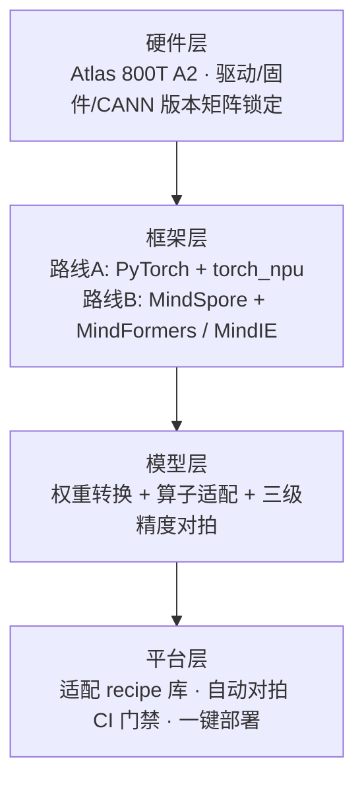

# 难点一：昇腾 910B 异构适配 —— 详细解决方案

> 对应《项目实现难点分析.md》难点一。既作为工程执行手册，也作为面试深挖的弹药库。
> 涉及的版本号均为基线示例，实际以交付时的华为配套版本表为准。

---

## 0. 面试 30 秒总述（先背这段）

> "910B 适配难的不是换硬件，是换生态——CUDA 整条链路在昇腾上没有直接等价物。我们的解法是把适配拆成四个可复现的工程步骤：**版本基线锁定 → 权重与算子转换 → 三级精度对拍 → 分布式性能调优**，每一步都有 checklist 和自动化工具兜底，最后把适配经验沉淀成平台的 recipe 库和 CI 精度门禁。效果是：踩坑期适配一个模型要一周以上，标准化之后同类模型半天到一天——这也是简历里'交付 3 天 → 1 天'的主要来源。"

---

## 1. 问题全景：GPU 和昇腾到底差在哪

| 环节 | NVIDIA / CUDA | 昇腾 910B | 差异后果 |
|---|---|---|---|
| 计算架构与驱动 | CUDA Driver / Toolkit | 驱动+固件 + CANN（toolkit / kernels / nnae） | 驱动、固件、CANN 三者版本必须按配套表锁死 |
| 算子库 | cuDNN / cuBLAS | aclnn 算子库 / ATB（Ascend Transformer Boost）加速库 | 算子覆盖度、融合行为、精度行为都不同 |
| 框架 | 原生 PyTorch | torch_npu（PyTorch Adapter，简称 PTA）/ MindSpore | 两条平行路线，选型见 §2.2 |
| 通信库 | NCCL | HCCL | 初始化方式、环境变量、带宽特性不同 |
| 推理引擎 | TensorRT-LLM / vLLM | MindIE（ATB Models + MindIE-Service）/ vLLM-Ascend / SGLang-Ascend | 部署配置体系完全不同 |
| 设备监控 | nvidia-smi | npu-smi | 所有运维脚本要重写 |
| 图优化 | torch.compile / CUDA Graph | torchair（NPU 图模式） | decode 阶段 host 开销优化主要靠它 |
| 自定义算子 | CUDA kernel / Triton | Ascend C / TBE | 补缺失算子的成本高，优先找替代实现 |
| 精度调试 | 社区经验丰富 | msprobe / MindStudio 精度比对 | 必须自建"对拍"流程 |

四类核心差异总结：

1. **算子生态差异**：不是所有 CUDA 算子都有等价实现，缺失时要么找组合替代、要么定制开发；
2. **数值行为差异**：同样的 BF16/FP16 计算在两种硬件上累加顺序、融合方式不同，逐层误差天然存在，关键是把"正常误差"和"转换错误"区分开；
3. **工具链差异**：CUDA 侧报错信息丰富、社区方案多，CANN 侧报错晦涩，很多问题只能靠逐层排查；
4. **分布式通信差异**：HCCL 的初始化、拓扑、调参都和 NCCL 不同，性能分析方法要重新建立。

---

## 2. 总体方案：四层适配架构与路线选型

### 2.1 四层适配架构



### 2.2 路线选型：torch_npu vs MindSpore 系

这是昇腾适配的第一个架构决策，两条路线各取所长：

| | 路线 A：PyTorch + torch_npu | 路线 B：MindSpore + MindFormers / MindIE |
|---|---|---|
| 代码改动 | 小（换 device、少量 API 替换） | 大（模型定义、训练循环重写） |
| 权重 | **通常不用转换**，直接读 HF 权重 | 必须转换（命名/结构差异，见 §4） |
| 生态 | DeepSpeed、LLaMA-Factory、ms-swift 等有 NPU 适配 | MindFormers 官方维护，功能最全 |
| 性能上限 | 中（依赖 aclnn 算子覆盖度） | 高（ATB 融合算子、图优化、量化成熟） |
| 适用场景 | 快速验证、微调任务、模型不在 MindFormers 支持列表时 | 生产训练与生产推理 |

**选型决策树**（面试可以直接讲这个）：

1. 模型在 MindFormers / MindIE 支持列表里？→ 是，生产训练/推理走路线 B；
2. 不在列表，但结构是 LLaMA / Qwen / Baichuan 系分支 → 路线 A 先快速打通验证，同时评估 B 的移植成本；
3. 定制结构（自研 attention、ALiBi 变体等）→ 路线 A 先行，缺失算子单独补；
4. 推理侧：生产服务优先 MindIE（稳定性 + 量化 + PD 分离成熟），评测对比 vLLM-Ascend / SGLang-Ascend；多轮对话前缀复用多的场景 SGLang 的 RadixAttention 有优势。

平台层面把两条路线统一调度：用户提交任务时只声明"模型 + 训练/推理 + 硬件类型"，路由层按决策树自动选路线。

### 2.3 版本矩阵与基线锁定

| 组件 | 基线（示例） | 备注 |
|---|---|---|
| 驱动 + 固件 | 与整机配套版本 | `npu-smi info` 核对 |
| CANN | 8.0 系列 | torch_npu 和 MindIE 都有最低版本要求 |
| torch + torch_npu | 2.x + 对应版本 PTA | torch 与 torch_npu 版本一一对应，不能混装 |
| MindSpore / MindFormers | 2.x / 对应分支 | ckpt 格式相关，跨版本要回归 |
| MindIE | 1.0 系列 | 依赖 CANN 8.0 |

三条铁律：

- **混版本是第一坑**：驱动固件降级、CANN 打了不同节点的 patch，都会出现"单机正常多机挂"这类诡异问题，所有节点统一容器镜像交付，从源头锁版本；
- **每次升级先跑冒烟集**：单算子、8 卡 all_reduce、单模型推理三个冒烟用例，过了再灰度；
- **版本矩阵进 CMDB**：哪个客户环境哪套版本，出问题能秒定位是不是版本组合问题。

---

## 3. 步骤一：环境基线建设

1. **容器化**：基于 CANN 官方镜像 + torch_npu + MindFormers/MindIE 打统一基础镜像，一个镜像铺平所有节点；
2. **设备健康检查**：`npu-smi info` 看卡数/显存/驱动版本；`npu-smi info -t usages -i <id>` 看利用率；
3. **通信冒烟**：torch_npu 跑 8 卡 all_reduce 带宽测试（对应 NCCL 时代的 nccl-tests），机间跑 all_reduce 跨节点带宽，**基线数据先测出来**，后面性能调优才有参照物；
4. **日志环境变量模板**：调试时统一开 `ASCEND_GLOBAL_LOG_LEVEL`、落盘 CANN 日志，避免现场抓瞎。

---

## 4. 步骤二：权重转换（三个层面：格式、命名、结构）

### 4.1 格式层（最简单的一层）

- PyTorch `.bin` / `.safetensors` → MindSpore `.ckpt`：MindFormers 每个模型目录提供 `convert_weight.py`；新版本部分支持 safetensors 直接加载，但生产上统一**预转换 + 落缓存**，便于审计和复用；
- 注意分片索引（`model.safetensors.index.json`）的合并与再切分逻辑；
- MindIE 侧多数原生模型**直接读 HF 权重、启动时自动转换**，但**量化版必须预转换**（见 §7.4）。

### 4.2 命名层（对照表驱动）

LLaMA 系典型映射（示意，以对应版本 MindFormers 模型定义源码为准，**不要背，要查**）：

| HuggingFace (PyTorch) | MindFormers (MindSpore) | 备注 |
|---|---|---|
| `model.embed_tokens.weight` | `model.tok_embeddings.embedding_weight` | |
| `model.layers.{i}.self_attn.q_proj/k_proj/v_proj` | `attention.wq / wk / wv` | 融合结构见 4.3 |
| `self_attn.o_proj` | `attention.wo` | |
| `mlp.gate_proj / up_proj / down_proj` | `feed_forward.w1 / w3 / w2` | SwiGLU 双上投影 |
| `input_layernorm` | `attention_norm` | |
| `post_attention_layernorm` | `ffn_norm` | |
| `model.norm` | `model.norm_out` | |
| `lm_head` | `lm_head` | |

### 4.3 结构层（真正的坑，三个典型）

**坑 1：QKV 融合与 per-head 排布。**
HF 大多是 q/k/v 三个独立矩阵；同系列不同型号可能不同——例如百川2 的 7B 用 `W_pack` 融合成一个 `[3H, H]` 矩阵、13B 用独立三矩阵（**以源码为准，不要按型号推测**）。目标侧（MindFormers 或 ATB kernel）期望的排布可能是 `[Q全量; K全量; V全量]`，也可能是 **per-head 交错**（特别是 TP 切分后 kernel 要求按 head 分组）。
*为什么这个坑最毒*：切错了权重数值分布完全正常、加载零报错、loss 也能算出来，但生成全是乱码——"权重串位"不改变统计特性。

**坑 2：RoPE 两种约定。**
`rotate_half`（GPT-NeoX / HF Llama 风格）vs `interleave`（GPT-J 风格，相邻两维为一对）。同一份权重在不同 kernel 的约定不同时，必须对 q/k 做维度重排或配置 `rotary_type` 开关。
*症状最隐蔽*：短文本完全正常，长文本/高位置 token 才开始错乱——低位置下两种实现差异极小，随位置累积放大。凡是"前 500 个 token 好、后面开始胡说"，第一反应查 RoPE。

**坑 3：模型特有结构。**
百川的 NormHead（lm_head 归一化）、百川1 的 ALiBi、Qwen 系 RMSNorm 的 eps、ChatGLM 的 post-LN——**"通用转换脚本"是个伪命题**，平台按模型卡片挂载专属转换脚本。

### 4.4 转换正确性验证：CPU 对拍先行

80% 的转换错误不需要 NPU 就能发现：

```text
1. 转换后 shape 全量自检（两侧模型逐参数 shape 对齐表）
2. CPU 对拍：两侧模型都加载到 CPU，同一输入跑前 N 层，逐层 cosine 比较
   —— 不占 NPU、迭代快，命名/转置/切分错误在这一步全部现形
3. CPU 对拍通过 → NPU 侧"加载 + 单 token 冒烟"
4. 冒烟通过 → 进入 §5 精度对齐流程
```

---

## 5. 步骤三：精度对齐方法论（适配耗时的大头）

> 结论先行：**适配最耗时的不是写转换脚本，是精度排查**——我们统计大约占整个适配工作量的一半以上，所以第一优先级是把对拍自动化。

### 5.1 三级对拍

| 层级 | 做法 | 目的 |
|---|---|---|
| ① 单层/单算子级 | 固定输入，GPU（golden）与 NPU 各跑一层，比较输出 | 定位"哪个层、哪个算子"发散 |
| ② 整模型 logits 级 | 固定 prompt 比较 next-token logits：top1 一致率、KL 散度 | 排除层间累积误差的干扰 |
| ③ 任务级 | 同一评测集（GSM8K / C-Eval 采样 100~200 题）两侧跑分 + 自由生成 diff 率 | 最终验收，锚定真实业务效果 |

### 5.2 工具链

- **msprobe**（华为官方精度比对工具，支持 torch_npu / MindSpore）：API 级 dump + 自动对齐比对，直接给出**第一个发散的算子和发散幅度**——把"逐层对拍"自动化了，是我们排查的主力工具；
- **MindStudio**：精度比对 + 算子级 profiling timeline；
- **自研对拍脚本 + CI 门禁**：GPU 侧跑一次存 golden（logits + 关键中间层），NPU 侧每个模型版本定期回归——这是平台化门禁的基础（§10）。

### 5.3 验收阈值（我们定的门禁，数字可讨论）

| 层级 | 指标 | 门槛 |
|---|---|---|
| 单层 | cosine 相似度 | > 0.999（BF16 下典型 0.9999） |
| 单层 | max abs diff | < 1e-2 |
| logits | top1 一致率 | > 99% |
| 任务 | 评测分差 | < 1 个点 |
| 生成（温度 0） | token diff 率 | < 1% |

关键点：**单层阈值只是烟雾测试，最终以任务级分差 + 人工盲测为准**——面试被问"阈值怎么定的"时这么答，比报死一个数更专业。

### 5.4 常见根因速查表

| 现象 | 高概率根因 | 处理 |
|---|---|---|
| 单层 cosine 低，Q/K/V 交叉错位 | QKV 切分/重排错误 | 修转换脚本 |
| 短文本正常、长文本崩 | RoPE 约定不一致 / 位置插值配置错 | 维度重排或改 `rotary_type` |
| loss 均值对、尾部发散 | softmax / norm 内部 BF16 累加精度 | 数值敏感算子内部 cast FP32 |
| 某层突然 NaN | 融合算子溢出未抑制 | overflow dump 定位 + 换实现 |
| 输出完全随机 | 权重转置 / reshape 错 | CPU 对拍即可发现 |
| GELU / SwiGLU 小幅偏差 | 近似实现不同（tanh vs erf） | 对齐实现，或确认对任务无影响后接受 |
| attention 层明显偏差 | 未走 FA 融合路径 / mask、RoPE 传参不对 | 换 `npu_fusion_attention` 并核对参数 |

### 5.5 排查 SOP

```text
1. 收敛现象：哪些 prompt / 多长上下文触发，固定可复现输入
2. logits 级对拍：发散发生在第 1 层还是深层？
   ├─ 第 1 层就发散 → 权重/结构问题，回 §4（CPU 对拍复查）
   └─ 深层才发散 → 数值累积问题，进入层内定位
3. 首个发散层内二分：embedding → attention → ffn → norm
4. 用 msprobe 报告定位到具体算子：实现差异 or 权重问题？
5. 权重问题 → 修转换脚本；实现问题 → 换算子 / 改配置 / 内部精度提升
6. 修复后：把该 case 加入 CI 对拍回归集，防止复发
```

调试期实用开关：`ASCEND_LAUNCH_BLOCKING=1`（同步执行，定位异步错位）、`ASCEND_GLOBAL_LOG_LEVEL=1`（DEBUG 日志）。

---

## 6. 步骤四：训练适配

### 6.1 MindFormers 路线要点

- 配置三件套：`compute_dtype/params_dtype`（**910B 优先 BF16**）、`use_flash_attention=True`、重计算（recompute）按显存开；
- LoRA：`target_modules / rank / alpha` 与 GPU 侧对齐做一次收敛性对照实验（两条硬件上 loss 曲线应重合，MAE < 1e-3 量级）；
- checkpoint 双向转换（HF ckpt ↔ MindSpore ckpt）打通，保证平台里 GPU 上训练的产物能迁到 NPU 续训、反之亦然。

### 6.2 torch_npu 路线要点

- DeepSpeed ZeRO-1/2/3 有 NPU 适配分支；LLaMA-Factory、ms-swift 官方支持 Ascend；
- 两个"白拿性能"的参数：`TASK_QUEUE_ENABLE=2`（算子下发队列优化）、`CPU_AFFINITY_CONF=1`（host 亲和性），host-bound 场景能提 10%~20% 吞吐；
- `PYTORCH_NPU_ALLOC_CONF=expandable_segments:True` 缓解显存碎片。

### 6.3 训练 NaN 三板斧

1. **换 BF16**：910B 原生支持 BF16，避开 FP16 动态 loss scale 这一大坨额外变量（910A 只有 FP16，所以老项目才被迫调 loss scale）；
2. **逐层 overflow 定位**：msprobe / overflow dump 找到首个出现 inf 的算子；
3. **数值敏感算子内部 cast FP32**：RMSNorm 归一化、RoPE、softmax、loss 计算——中间量用 FP32、存储仍是 BF16。

若必须 FP16（对齐旧基线），检查 loss scale 初值/步进与 NPU overflow 事件的联动行为是否与 CUDA 侧一致。

### 6.4 QLoRA 的坑与替代方案

- **bitsandbytes（NF4 4bit）官方不支持 NPU**，社区适配版稳定性一般——这是面试容易被追问的点；
- 我们的实际方案：**W8A16 校准量化后的权重 + LoRA 微调**（MindFormers/ModelSlim 路线），显存目标同样达成、数值稳定性远好于 4bit 路线；W4A16 主要用于推理侧压缩，不用于训练。

### 6.5 断点续训（NPU 特有点）

不只存模型权重：optimizer 状态、LR scheduler 进度、dataloader 消费位置都要存，且**多卡下每个 rank 的状态 shard 必须对齐恢复**，否则续训曲线跳变。平台统一做续训完整性校验（恢复后先空跑几个 step 对比 loss 连续性）。

---

## 7. 步骤五：推理适配

### 7.1 引擎选型

| 引擎 | 定位 | 优势 | 注意点 |
|---|---|---|---|
| MindIE（ATB Models + MindIE-Service） | 生产推理 | 量化成熟（W8A16/W4A16）、PD 分离、与 CANN 深度协同、OpenAI 兼容服务 | 部署配置较复杂，模型需在支持列表 |
| vLLM-Ascend | 生态 / 评测 | 跟 vLLM 上游同步、代码几乎零改动 | 性能要开 torchair 图模式才好看 |
| SGLang-Ascend | 多轮对话 | RadixAttention 前缀复用 | 较新，生产验证少，先评测后上 |

### 7.2 MindIE 部署要点

- 非量化模型多数直接读 HF 权重、启动时自动转换；**量化模型必须预转换**；
- mindie-service 配置关键项：`npuDeviceIds` / `worldSize`（= TP 卡数）、`maxSeqLen` / `maxBatchSize`、`npuMemSize`（显存预留）；服务自带 OpenAI 兼容 API，平台统一接网关；
- 部署模板化：把各模型的 mindie-service 配置做成模板，这是"部署 1 天 → 30 分钟"的直接来源。

### 7.3 vLLM-Ascend 要点

- 以 plugin 形式安装（vllm + vllm-ascend + torch_npu 三者版本配套）；
- `tensor_parallel_size` 控 TP；**torchair 图模式打开后 decode 的 host 开销显著下降**——不开图模式的 decode 吞吐基本是 host-bound；
- prefix caching、chunked prefill 等特性按版本确认支持情况，评测时固定版本跑对比。

### 7.4 量化

- 主力方案：**W8A16**（SmoothQuant，msmodelslim 校准，几百条校准集即可）→ 生产默认；
- 显存极限场景：W4A16 → 精度回归必须重跑（任务级门禁不能省）；
- GPTQ/AWQ 在 NPU 上支持度因引擎版本而异，评测后再定。

### 7.5 验收标准

GPU golden 对比（同 prompt 生成 diff 率）+ 长文本压力（8k/16k 上下文不崩）+ 性能基线（吞吐/TTFT 达标线）三关全过才允许上线。

---

## 8. 步骤六：多机多卡调优

### 8.1 拓扑与通信（先懂硬件再谈调优）

- **机内**：Atlas 800T A2 单机 8 卡通过 HCCS 全互联，带宽高、延迟低 → **TP 放机内**；
- **机间**：200G RoCE 多端口，带宽比机内低一个数量级 → 跨机用 PP / DP / EP；
- **无损网络是外部前提**：机间 PFC/ECN 必须和交换机侧配置对齐，否则大 all_reduce 丢包重传、带宽腰斩——**多机吞吐不达标的头号原因往往在网络配置而不是代码**。

HCCL 关键项：

- torch_npu：`init_process_group(backend="hccl")`，torchrun 拉起；`HCCL_SOCKET_IFNAME`（对应 NCCL 的 SOCKET_IFNAME）、`HCCL_IF_IP` 指定通信网卡/IP；
- MindSpore：RANK_TABLE_FILE（`hccl_tools.py` 生成）；
- `HCCL_BUFFSIZE`（单位 MB）：通信 buffer 大小，带宽与显存占用的平衡旋钮；
- `HCCL_EXEC_TIMEOUT`：跨机同步超时，调试网络抖动时关注。

### 8.2 并行策略参考

| 模型规模 | 训练 | 推理 |
|---|---|---|
| 7B / 13B | LoRA 单卡 / Full 单机 8 卡 + ZeRO | TP2 / TP4（MindIE） |
| 34B / 70B | 机内 TP8 或 TP4×PP2 + ZeRO | TP8 单机，或跨机 PP |
| MoE | 机内 DP/TP + 跨机 EP | EP 优先 |

### 8.3 Profiling 方法与瓶颈对策

用 msprof / MindStudio timeline 看三类 gap：

| 症状 | 根因 | 对策 |
|---|---|---|
| 通信等待大 | TP 各卡不均衡 / 网络丢包 | 查负载均衡；核对无损网络配置 |
| decode 吞吐上不去、GPU util 不满 | host 端 kernel launch 开销主导 | torchair 图模式 / 减小 CPU 端逻辑 |
| prefill 慢、HBM 带宽打满 | 算子未融合、padding 浪费 | 开 FA/融合算子、调 `TASK_QUEUE_ENABLE`、序列打包 |
| 多机扩展比远低于线性 | 跨机通信占比高 | 并行策略重排（跨机 PP/EP）、梯度/通信 overlap |

调优叙事模板（面试用）：先测基线 → timeline 定位 → 网络修复 + overlap + 图模式 → 前后对比给数字（用自己的真实数据填）。

---

## 9. 完整实战案例：Baichuan2-13B-Chat 迁移 910B

> 按 STAR 结构背：背景 → 现象 → 四步定位 → 两次修复 → 训练侧问题 → 沉淀。

**背景**：客户场景要把 Baichuan2-13B-Chat 迁到 910B，MindFormers 做微调（SFT/LoRA），MindIE 做生产推理。

**现象**：HF safetensors → ckpt 转换后加载成功、零报错，但 NPU 侧生成全是乱码复读；GPU 侧 PPL 约 6.5，NPU 侧 PPL 上千。

**定位（四步，约一天）**：

1. 排除 tokenizer：同一文本两侧 encode 的 token id 完全一致 → 排除词表问题；
2. 整模型 logits 对拍：第一个 token 就发散 → 问题在底层，不在长程累积；
3. 单层对拍：固定输入跑 layer 0，attention 输出 cosine 只有 ~0.3 → 锁定 attention 内部；
4. 层内二分到 Q/K/V 投影输出：发现相似度是"交叉错位"的（NPU 的 K 与 GPU 的 Q 最相似）→ **QKV 切分错误实锤**。

**根因与修复 1**：转换脚本沿用了同系列另一型号的 QKV 结构假设——Baichuan2 系列 7B 用 `W_pack` 融合、13B 是独立 q/k/v 三矩阵（以源码为准），脚本照搬导致串位。修正切分逻辑并按 `num_heads` 重排后，单层 cosine 从 0.3 恢复到 0.9999+，生成恢复正常。

**根因与修复 2**：修完 QKV 后冒出第二个问题——2k token 以上的长文本开始错乱（正是 §4.3 坑 2 的症状）。定位到 RoPE 约定差异（rotate_half vs interleave），对 q/k 做维度重排后，8k 上下文 PPL 与 GPU 差 < 0.3%。

**训练侧**：FP16 + GradScaler 首个 epoch loss NaN → 换 BF16（910B 原生支持）+ RMSNorm/RoPE 内部 cast FP32 后稳定；LoRA 收敛曲线与 GPU 侧重合（MAE < 1e-3）。

**沉淀**：产出百川系转换脚本 + 三级对拍脚本 + checklist，进平台 recipe 库；后续同类 LLaMA 系分支模型（含浪潮侧定制模型）适配压缩到半天内完成。

**面试讲法提示**：这个案例的价值不在"修了两个 bug"，在于展示**方法论**——不猜、逐层二分、CPU 对拍先行、修复后进回归集。最后主动补一句"后来我们把这套 SOP 做成了 CI 门禁"，把个案升华成平台能力。

---

## 10. 平台化沉淀（呼应简历数字）

### 10.1 适配 recipe 库

每个模型一张"适配卡片"：

```yaml
model: baichuan2-13b-chat
arch: llama-variant
quirks:            # 已知特有结构
  - qkv: separate_13B_fused_7B   # 必须按源码核对
  - normhead: true
convert: baichuan2_convert.py    # 专属转换脚本
golden: gs://golden/baichuan2-13b/logits.pt
inference:
  engine: mindie
  quant: w8a16
  world_size: 4
known_issues: [...]              # 历史踩坑记录
```

### 10.2 自动对拍 CI 门禁

```python
gate = {
    "smoke":       "50 tokens 生成、首 token 非乱码",
    "layer_check": "单层 cosine > 0.999",
    "logit_check": "top1 一致率 > 99%",
    "task_check":  "评测集采样分差 < 1 点",
    "perf_check":  "吞吐 ≥ 基线 90%，TTFT ≤ 阈值",
}
# 任何一项不过 → 禁止发布，差异报告自动归档
```

### 10.3 一键适配流程


### 10.4 提效口径（面试被追问"数字怎么算的"时）

- **适配 3 天 → 1 天**：踩坑期单模型 5~7 天（转换返工 + 精度排查），标准化后转换模板化、对拍自动化、已知坑有 recipe 兜底，同类模型 0.5~1 天；
- **部署 1 天 → 30 分钟**：mindie-service/vLLM 配置模板 + 统一镜像 + 门禁自动化，人工只剩填参数和等验收；
- 统计口径：以"从拿到模型权重到生产端点可用"的自然日计，取近 N 个模型的中位数，不是拍脑袋。

---

## 11. 面试深挖 Q&A 速答

1. **Q：为什么不全用 torch_npu，还要搞 MindSpore？**
   A：路线 A 迁移成本低适合快速验证和微调；路线 B（MindFormers/MindIE）性能上限高、生产量化和 PD 分离成熟。平台双路线统一路由，按模型支持度和场景选。

2. **Q：精度对拍阈值怎么定的？**
   A：单层 cosine 0.999 只是烟雾测试；最终锚定任务级（评测分差 < 1 点）+ 温度 0 生成 diff 率 < 1% + 人工盲测，避免"阈值达标但业务变差"。

3. **Q：转换后输出乱码，第一步做什么？**
   A：不猜。先 tokenizer 排除，再 logits 对拍定位发散层级，首个发散层内二分；CPU 对拍先行把权重类问题在上 NPU 之前解决。

4. **Q：msprobe 具体怎么用？**
   A：GPU 侧与 NPU 侧同一套埋点 dump API 输入输出，工具自动对齐比对，输出第一个发散算子及幅度——把人工逐层对拍自动化。

5. **Q：训练 NaN 怎么处理？**
   A：三板斧——换 BF16、overflow dump 逐层定位、数值敏感算子内部 FP32。910B 支持 BF16，尽量避开 FP16 loss scale 那套变量。

6. **Q：QLoRA 在 NPU 上怎么办？**
   A：bitsandbytes 官方不支持 NPU，4bit 路线不成熟；我们的方案是 W8A16 校准量化 + LoRA，显存目标同样达成且稳定。

7. **Q：910B 和 910A 区别？**
   A：910A 只有 FP16，老项目被迫调 loss scale；910B 原生 BF16、HCCS 机内互联成熟、算力和显存都上一个台阶，迁移老代码最大收益就是直接切 BF16。

8. **Q：多机调优做过什么？**
   A：先测基线（机内/机间 all_reduce 带宽），无损网络 PFC/ECN 与交换机侧对齐（多机不达标的头号原因），并行策略 TP 机内 / PP·EP 机间，decode 用 torchair 图模式压 host 开销。

9. **Q：适配里最耗时的环节？**
   A：精度对齐排查，占一半以上——所以第一个平台化动作就是把对拍做成 CI，而不是继续堆人力。

10. **Q："10+ 模型"具体哪些？**
    A：LLaMA 系、Qwen 系、Baichuan2、ChatGLM，浪潮侧定制分支，以及 bge 系 Embedding/Reranker——后者结构简单、精度敏感度低，在 NPU 上反而最顺利。

---

## 附：关键命令与环境变量速查

```bash
# 设备与版本
npu-smi info                          # 卡状态（对应 nvidia-smi）
cat /usr/local/Ascend/ascend-toolkit/latest/version.cfg  # CANN 版本

# 调试
export ASCEND_GLOBAL_LOG_LEVEL=1      # DEBUG 日志
export ASCEND_LAUNCH_BLOCKING=1       # 同步执行，定位异步错位

# 性能
export TASK_QUEUE_ENABLE=2            # 算子下发队列优化（host-bound 场景）
export CPU_AFFINITY_CONF=1            # host CPU 亲和
export HCCL_SOCKET_IFNAME=eth0        # 指定通信网卡
export HCCL_BUFFSIZE=400              # 通信 buffer（MB），带宽/显存平衡

# 分布式
torchrun --nproc_per_node=8 --nnodes=N train.py   # torch_npu 多机拉起
python hccl_tools.py --device_num "[0,8)..."      # MindSpore rank table 生成
```
